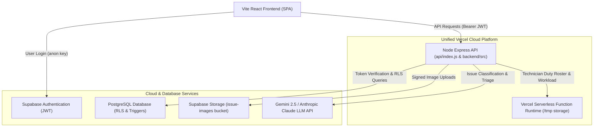

# Design

## Architecture overview

UniVoice is built as a single, unified full-stack architecture. The Vite React client provides dual interfaces: a Student Self-Service Portal and a Manager Operations Hub. All browser requests communicate through an Express API normalized under `/api`, authenticated via Supabase JWT bearer tokens. The backend accesses PostgreSQL using both Row-Level Security policies and secured database functions, preventing cross-tenant data leakage.

## Components

| Component | Responsibility | Technology |
|-----------|----------------|------------|
| **Frontend Web App** | Responsive UI for student issue reporting, duplicate joining, manager triage queues, SLA analytics, and technician assignment | React 19, Vite, Tailwind CSS, Lucide Icons |
| **API Serverless Handler** | Route dispatching, input validation (Zod), rate limiting, AI suggestion signing, and technician state management | Express 5, Node 22, Vercel Serverless Function |
| **Database & Security Rules** | Enforces status transition guards, role-based row access (RLS), auto-escalated SLA view, and catalog lookups | PostgreSQL 15 (Supabase), SQL Triggers, Functions |
| **AI Classifier Service** | Analyzes natural language incident descriptions to predict category, department, and priority with schema enforcement | Google Gemini API (`gemini-2.5-flash` / `gemini-3.5-flash-lite`) / Anthropic Claude fallback |
| **Object Storage** | Encrypted multi-part image uploads for evidence photos with randomized unique keys | Supabase Storage (`issue-images` bucket) |

## Data model

The PostgreSQL relational model enforces domain integrity and privacy through foreign keys and security triggers:

- **`profiles`**: User metadata linking to `auth.users(id)`. Contains `role` (`'user'` or `'admin'`), `department_id`, and display names.
- **`departments`**: Operational units (e.g., Electrical, HVAC, Plumbing, Structural, Safety).
- **`categories`**: Specific problem categories linked to default responsible departments and base priorities.
- **`issues`**: Core incident entity containing `title`, `description`, `building`, `room`, `priority` (`'low'`, `'medium'`, `'high'`), `status` (`'open'`, `'in_progress'`, `'resolved'`, `'closed'`), `priority_sla` (deadline timestamp), `ai_used` (boolean), `assigned_technician_id`, and `created_at`.
- **`issue_supporters`**: Relational join table mapping other students who reported the same duplicate issue (`issue_id`, `user_id`, `joined_at`).
- **`status_history`**: Immutable audit log of every workflow state change, recording previous status, new status, note, and updating user.
- **`issue_overview`**: `security_invoker` database view computing real-time `is_overdue` flags based on `priority_sla < now()`.

## API / interfaces

| Method | Endpoint / interface | Purpose | Auth required |
|--------|----------------------|---------|---------------|
| `GET` | `/api/health` | Service health check, active AI status, and loaded LLM model | No |
| `GET` | `/api/emergency/catalog` | Campus emergency phone directory and protocols | No |
| `POST` | `/api/auth/signup` | Student registration with profile initialization | No |
| `GET` | `/api/me` | Fetches signed-in user profile, role, and department | Yes (User/Staff) |
| `GET` | `/api/meta` | Retrieves catalog of campus departments, categories, and SLA tiers | Yes (User/Staff) |
| `POST` | `/api/ai/classify` | Sends report text to LLM and returns signed suggestion token | Yes (User) |
| `POST` | `/api/issues/duplicates` | Scans open tickets in the same building for potential duplicates | Yes (User) |
| `POST` | `/api/issues` | Submits new issue with optional photo, signed AI token, or manual triage | Yes (User) |
| `POST` | `/api/issues/:id/join` | Attaches user to an existing duplicate ticket as a co-supporter | Yes (User) |
| `GET` | `/api/issues/mine` | Retrieves all issues submitted or supported by current student | Yes (User) |
| `GET` | `/api/issues/:id` | Detailed view of an issue (accessible by submitter or department staff) | Yes (User/Staff) |
| `GET` | `/api/staff/issues` | Manager triage queue of department issues, SLA filters, overdue items | Yes (Staff) |
| `PATCH` | `/api/staff/issues/:id/status` | Advances state machine status with mandatory notes | Yes (Staff) |
| `GET` | `/api/staff/technicians` | Duty roster with active workload counts and availability | Yes (Staff) |
| `PATCH` | `/api/staff/issues/:id/assign` | Dispatches work order to specific technician with handover notes | Yes (Staff) |

## Key decisions and tradeoffs

| Decision | Options considered | Chosen | Why | Tradeoff accepted |
|----------|--------------------|--------|-----|-------------------|
| **Unified Vercel Deployment** | Separate frontend (Vercel) + standalone VM (Render/Railway) | Single repository unified Vercel build (`vercel.json` rewrite to `/api`) | Eliminates cross-origin CORS latency, simplifies CI/CD, and enables zero-config deployment | Requires serverless awareness (using `/tmp` for writable storage) |
| **AI Suggestion Signing** | Trust client payload vs. server re-evaluating on submission | Cryptographic HMAC SHA-256 suggestion tokens | Prevents malicious users from tampering with AI triage results or spoofing urgency tiers | Requires server-side `SUGGESTION_SECRET` and expiration TTL management |
| **Student Anonymity** | Expose student profiles to facilities staff vs. complete isolation | Database-enforced isolation (staff see issue count and notes only) | Prevents retaliation or bias, encouraging honest reporting of campus safety defects | Staff cannot directly contact student by name (communication through ticket audit log) |
| **State Machine Enforcement** | Application code checks vs. PostgreSQL Triggers | PostgreSQL Trigger (`issues_guard`) + RPC Functions | Guarantees business logic integrity even if an administrative script or API bug occurs | Workflow changes require database migration |

## AI components

1. **Role of AI**: The AI classifier ingests the user's natural language `title`, `description`, and `location` to recommend:
   - Specific Category (e.g., "Lighting & Power Outlets", "Air Conditioning & Ventilation")
   - Responsible Department (e.g., "Electrical", "HVAC", "Plumbing")
   - SLA Priority Level (`high` - 24 hours, `medium` - 72 hours, `low` - 7 days)
2. **Code Validation & Safety**:
   - The LLM output is strictly validated against pre-seeded category and department IDs.
   - The server signs the verified suggestions using `createSuggestionToken(userId, suggestion)`.
   - On submission, `readSuggestionToken` validates the cryptographic signature and expiration TTL.
3. **Resilience & Fallback**:
   - If AI fails (timeout, rate limit, quota exhaustion, or missing API key), the system automatically defaults to **Full Manual Mode**.
   - Students can freely bypass AI at any step by clicking "Assign Priority & Category Manually".

## Security and privacy

### Threat model
- **Malicious Priority Elevation**: A student alters the request payload to mark a minor issue as `high` priority to jump the queue. *Mitigated by cryptographic HMAC verification and database guard triggers.*
- **Cross-Department Ticket Tampering**: A manager from department A attempts to resolve or close tickets from department B. *Mitigated by SQL RLS policies checking `profiles.department_id = issues.department_id`.*
- **Reporter Identification & Profiling**: Staff attempt to correlate student IDs with reported defects. *Mitigated by views that strip `user_id` and random hash file naming for photos.*

### Data handled
- Campus locations (building names, room numbers).
- Incident descriptions and equipment defect descriptions.
- Technical duty assignments (technician names, radio channels, zones).
- Anonymous student accounts authenticated via hashed passwords and Supabase JWTs.

### Known limits
- Supabase free-tier connection pooling limits high concurrent socket connections.
- Serverless ephemeral instances do not maintain long-running in-memory WebSockets (managed via Supabase Realtime).

